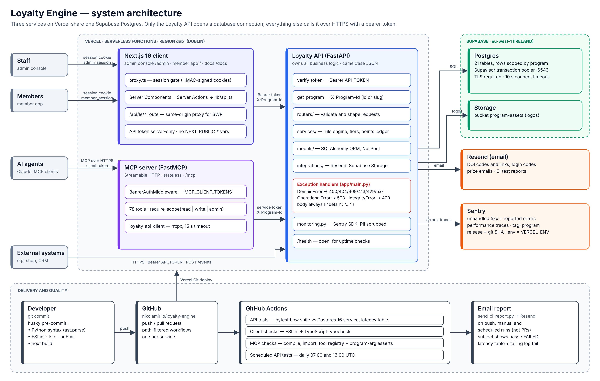

# Loyalty Engine: Technical Architecture

The diagram is generated by [`make_diagram.py`](make_diagram.py). To get the
PNG, run [`render_png.js`](render_png.js).

## 1. Overview

| Service | Tech | Role |
|---|---|---|
| **Loyalty API** (`api/`) | FastAPI, SQLAlchemy, Python 3.11 | All business logic. The only service that connects to the database. |
| **Client** (`client/`) | Next.js 16, React 19, SWR | Admin console (`/admin`), member app (`/`), user docs (`/docs`) |
| **MCP server** (`mcp-server/`) | FastMCP, Streamable HTTP | 78 tools for AI agents |
| **Database** | Supabase Postgres and Storage | 21 tables, plus a bucket for program logos |

Everything runs on Vercel in `dub1` (Dublin), next to the Supabase project in
`eu-west-1`. The client and the MCP server reach the database only by calling
the API over HTTPS with a bearer token.

## 2. Key design points

- **API layers:** routers → services → models and integrations. Services never
  import FastAPI.
- **Responses:** JSON fields are always camelCase.
- **Multi-program:** the `X-Program-Id` header (UUID or slug) picks the
  program. Without it, the request goes to the default program and a warning is
  logged. Points, tier and progress are kept per program. Identity and email
  verification are shared across programs.
- **Points:** every balance change goes through `record_transaction`. That one
  call writes the ledger row, updates the balance and re-applies the tier.
- **Concurrency:** balance, stock and progress writes lock their rows with
  `SELECT ... FOR UPDATE`.
- **Events:** sending the same `eventId` again returns the first result and
  runs no rules a second time.
- **Client:** the browser never calls the API. All traffic goes through Server
  Components, Server Actions, or the `/api/le` proxy. The token is
  `server-only`.
- **Schema changes:** `create_all` creates new tables. Changes to existing
  tables need SQL in `supabase/migrations/`, applied before the deploy that
  needs it.

## 3. Security

| Area | How it works |
|---|---|
| API | One bearer token (`API_TOKEN`), compared in constant time and applied to every router. Only `/health` is open. |
| Staff | Username and password. 3 failed attempts lock out the IP for 10 minutes (held in memory). |
| Members | Passwordless email code: 10-minute expiry, 5 attempts, stored only as a hash. The response never reveals whether an email is registered. |
| Sessions | HMAC-signed, `httpOnly` cookies. Admin sessions last 7 days, member sessions 30 days. |
| Email abuse | A person can request a new code once per 60 seconds. Earlier requests get `429` with `Retry-After`. |
| MCP | Each agent has its own token and scopes (`read`, `write`, `admin`), separate from the API token. Host and origin checks guard against DNS rebinding. CORS allows only `claude.ai`. |

## 4. Error handling

**API.** Services raise domain errors from `app/core/errors.py`. One handler in
`app/main.py` turns each into an HTTP response with the body
`{"detail": "..."}`.

| Error | Status |
|---|---|
| `InvalidInput` / `NotFound` / `Conflict` | 400 / 404 / 409 |
| `PayloadTooLarge` / `RateLimited` | 413 / 429 (with `Retry-After`) |
| `Misconfigured`: setup is wrong, retrying won't help | 500 |
| `UpstreamError`: Resend or Storage failed, worth retrying | 502 |
| `FeatureUnavailable`: optional settings are missing | 503 |
| Database unreachable (`OperationalError`) | 503 |
| Unchecked constraint (`IntegrityError`) | 409 |

- **Email:** Resend 4xx errors such as a bad key or an unverified domain become
  500. A 429, a 5xx or a network error becomes 502. Codes are sent before
  anything is written, so a failed send changes nothing. A failed prize email
  doesn't fail the request: the response says `emailSent: false` and Sentry
  gets a report.
- **Startup:** missing required environment variables stop the service from
  starting. A database error during `create_all` is logged, and the app still
  boots.

**Timeouts.** Every limit is set to fail cleanly before Vercel stops the
function at 10 seconds:

| Hop | Limit |
|---|---|
| Database connect | 10 s |
| Resend | 10 s |
| Client proxy (`/api/le`) | 8 s, then `504` |
| MCP server to API | 15 s |

**Client.**
- `lib/api.ts` and `/api/le` make up to 3 attempts on network errors and on
  502, 503 and 504. They never retry a 500.
- Server Actions return `{ ok, error }` and show the API's message. Any other
  error is logged and the user sees a generic message.
- `error.tsx` is the error boundary, with **Try again** and **Reload**.

**MCP.** Any non-2xx response from the API becomes a tool error with the API's
`detail`. A bad token gets `401`.

## 5. Monitoring

**Sentry** runs in the API only, and only when `SENTRY_DSN` is set.

- **What reaches it:**
  - every unhandled 500
  - 5xx domain errors
  - handled failures sent with `report()`: database unavailable, unchecked
    constraint, `create_all` failure, failed prize email
- **Context:** `environment` comes from `VERCEL_ENV`, `release` from the git
  SHA, and every event is tagged with its `program`. Traces are on, with the
  rate set by `SENTRY_TRACES_SAMPLE_RATE` (default 1.0).
- **Privacy:** no IPs, cookies or local variables are sent. `email`, `name`,
  `phone` and `code` are masked at any depth.
- **Logs:** logs become breadcrumbs only, so no error is reported twice.

**Logs and health checks**
- **Logs:** Vercel function logs. They include warnings when a request falls
  back to the default program or the pooler URL is rewritten, plus the
  provider's own reason for each email failure.
- **Health:** `GET /health` (API) and `GET /healthz` (MCP). Neither needs auth.

**Scheduled test runs:** the API tests run daily at 07:00 and 13:00 UTC and
email a report, so regressions and slow routes show up without a push.

## 6. Testing and CI

| Stage | Checks |
|---|---|
| **Pre-commit** (Husky) | Python syntax. For client changes: ESLint, `tsc --noEmit` and `next build`. |
| **API tests** (push or PR on `api/**`) | `pytest` against a Postgres 16 service container. The latency table goes to the run summary, an artifact and an email. |
| **API tests, scheduled** | The same workflow, run daily at 07:00 and 13:00 UTC |
| **Client checks** (push or PR on `client/**`) | ESLint and TypeScript typecheck |
| **MCP checks** (push or PR on `mcp-server/**`) | Compiles and imports the server. Fails on duplicate tool names or on a tool missing its `program` argument. |

- **Flow suite** (20 tests): covers the member, points, reward and prize
  lifecycle, plus event types, rules, retries and limits. It runs against real
  Postgres and refuses to start without `TEST_DATABASE_URL`. Sentry is forced
  off.
- **Email report:** sent through Resend. The subject reads `✅ passed`,
  `🔴 FAILED` or `⚠️ did not run`. Failed runs include the end of the pytest
  log. No email is sent for pull requests.
- **Regression scripts** (11, in `api/tests/regression/`): each one guards
  against a past incident, such as pooler exhaustion, email error handling,
  code resends, program isolation or tier sync. They run on SQLite and must be
  started by hand.

## 7. Deployment

- **Platform:** each service is its own Vercel project, deployed through the
  Git integration and pinned to `dub1`.
- **Database connection:** the Supabase transaction pooler on port 6543, with
  `NullPool`, TLS and a 10-second connect timeout. A session pooler URL (port
  5432) is rewritten automatically and a warning is logged.
- **Release order:** SQL migrations first, then the API, then the client and
  the MCP server.

| Service | Required environment variables |
|---|---|
| API | `DATABASE_URL`, `API_TOKEN`, `RESEND_API_KEY`, `EMAIL_FROM` |
| Client | `API_TOKEN`, `ADMIN_USERNAME`, `ADMIN_PASSWORD`, `AUTH_SECRET` |
| MCP | `LOYALTY_API_BASE_URL`, `LOYALTY_API_SERVICE_TOKEN`, `MCP_CLIENT_TOKENS` |
| CI | secret `RESEND_API_KEY`; variables `CI_REPORT_FROM`, `CI_REPORT_TO` |

## 8. Runbook

| Symptom | Fix |
|---|---|
| API `503`, or `EMAXCONNSESSION` in the logs | Check the Supabase project status. Make sure `DATABASE_URL` uses port 6543. |
| Email endpoints return `500` "domain is not verified" | Verify the `EMAIL_FROM` domain in Resend. |
| Email endpoints return `502` | Resend is rate-limiting or down. Retry. |
| Logo upload returns `503` | Set `SUPABASE_URL` and `SUPABASE_SERVICE_ROLE_KEY`. |
| MCP returns `421` | Add the host to `MCP_ALLOWED_HOSTS`. |
| Data lands in the wrong program | The caller left out `X-Program-Id`. Search the logs for "fell back to the default program". |

## 9. Known gaps

1. The regression scripts don't run in CI.
2. The client and the MCP server have no Sentry.
3. `/health` doesn't check the database, and no uptime alerting is set up.
4. The client has no tests, and no Python linter runs in CI.
5. Every backend caller shares one `API_TOKEN`.
6. The staff login lockout is held in memory, so each serverless instance
   keeps its own count.
